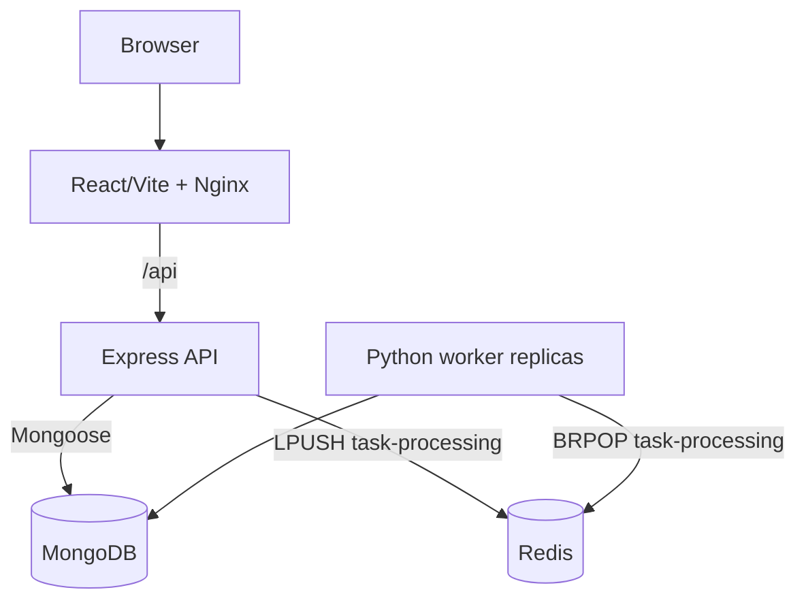

# TaskFlow AI Architecture

## 1. System overview

TaskFlow AI uses a React/Vite dashboard, Express REST API, MongoDB persistence, Redis task queue, and Python worker. The browser authenticates with a JWT and calls `/api` routes. Project and task records are owned by the authenticated user.

## 2. Request and task flow

1. The user registers or logs in. bcryptjs hashes passwords and the API signs a JWT.
2. The API validates project ownership and creates a task with `pending` status.
3. The API pushes `{ taskId }` to Redis `task-processing`.
4. A worker removes the job with `BRPOP`, reads the task, atomically updates it toward `running`, executes one of four operations, and stores result/log/status in MongoDB.
5. The dashboard polls task/project endpoints every 3–5 seconds.

The worker implementation currently uses Redis list semantics, not an acknowledged Redis Streams consumer group. It does not currently provide the reliability guarantees of a transactional outbox or guaranteed retry/dead-letter queue.

## 3. Worker scaling

Multiple worker pods may run without duplicate global coordination because each Redis list consumer removes a job. This is adequate for horizontal throughput on the current implementation, but duplicate delivery or crash windows require reprocessing rules. Every worker should:

- Claim at most one job per loop iteration.
- Use a unique task-ID idempotency check.
- Avoid overwriting `success` or `failed` task results with stale work.
- Persist terminal status before acks in a future Streams implementation.
- Scale replicas with queue depth and CPU rather than fixed assumptions.

## 4. Capacity: 100,000 tasks/day

100,000 tasks/day averages 1.157 tasks/second, or approximately 1.16 jobs/second. Production sizing must be based on measured peak and payload sizes. For example, a 5× peak is about 5.8 jobs/second; a 10× burst peak is about 11.6 jobs/second. These are steady-volume approximations, not performance guarantees.

Before production scale claims, run load tests at 2×/5×/10× expected peak, measure API latency, Redis pending depth, Mongo write latency, worker processing time, pod CPU/memory, and failure recovery. A start size of 2 worker replicas is sensible for availability, while the Kubernetes HPA or queue-depth autoscaler can add replicas based on observed backlog.

## 5. MongoDB indexing

At minimum, production indexes should include:

- `users.email` unique
- `tasks.createdBy + createdAt` for user history
- `tasks.projectId + createdAt` for project task history
- `tasks.createdBy + status + createdAt` for dashboard/status filtering
- `tasks.status + updatedAt` for processing recovery and cleanup

Outbox or job-state collections should use unique task/job keys and status/pending indexes if the reliability design is upgraded.

## 6. Redis failure and recovery

The current Redis client reconnect behavior depends on ioredis/redis-py defaults and the worker can requeue a job on caught processing/service exceptions. Redis and Mongo outage behavior is not yet equivalent to durable transactional publishing:

- A task saved before Redis publish can remain pending if Redis is unavailable.
- `BRPOP` removes a job before processing completes.
- A worker crash after removal can lose that pending job.
- The current queue has no Redis acknowledgements, retry counters, exponential backoff, pending-entry recovery, or dead-letter stream.

A production upgrade should use a Mongo transaction/outbox plus Redis Streams, consumer groups, `XACK`, pending-entry claim recovery, bounded retries, retry delays, and a dead-letter stream. Redis persistence and managed Redis availability should be operational requirements.

## 7. Deployment and environments

Staging should use a separate namespace and secret set. Production should use replica counts, resource limits, persistent storage, external secret management, TLS, and monitoring. Docker Compose is for local development. Kubernetes manifests support the application in staging/production overlays. Argo CD automates reconciliation, pruning, and self-healing from the infrastructure repository.

## 8. Security

- bcrypt password hashing
- JWT authentication
- Helmet and basic/global rate limiting
- JWT and database secrets only through environment/Kubernetes Secrets
- No credentials in source or manifests
- CORS restricted to `CLIENT_URL`
- Least-privilege container users and network-only database exposure

For production, add TLS, secret rotation, external secret management, non-root Redis/Mongo policies, network policies, audit logging, and dependency vulnerability scanning.

## 9. Observability and trade-offs

At present, task logs are strings with timestamps/severity where the worker produces them. Production observability should include structured application logs, Prometheus metrics, queue depth monitoring, Mongo metrics, worker processing latency/error counters, and distributed request/task IDs.

The chosen list queue is simple and testable. Redis Streams plus outbox processing is the recommended reliability trade: higher implementation complexity, bounded retries, and durable task recovery in exchange for no silently lost jobs.
