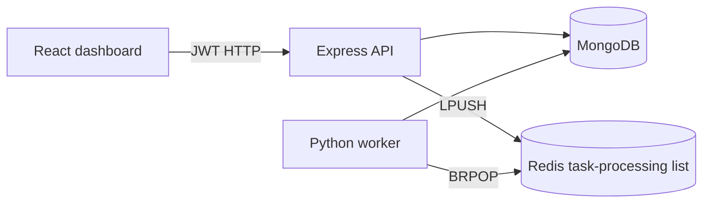

# TaskFlow AI

TaskFlow AI is a full-stack asynchronous text-processing platform built with React, Node.js, Express, MongoDB, Redis, Python, Docker, Kubernetes, and GitHub Actions.

## Architecture



## Features

- Registration/login with bcrypt password hashing and JWT authentication
- Authenticated project CRUD and task CRUD
- Uppercase, lowercase, reverse-string, and word-count operations
- Pending/running/success/failed task status and persisted logs/results
- Dashboard and task-detail polling
- Docker Compose local environment
- Kubernetes/Kustomize, Argo CD, and GHCR-ready CI/CD assets

## Repository structure

```text
taskflow-ai/
├── frontend/       React/Vite dashboard
├── backend/        Express API
├── worker/         Python Redis/Mongo task worker
├── docker-compose.yml
└── .github/workflows/ci.yml

TaskFlow infrastructure is maintained in taskflow-ai-infra.
```

## Prerequisites

- Docker with Compose
- Node.js 22+
- Python 3.12+
- MongoDB and Redis for non-Compose local development

## Environment variables

Copy `.env.example` at repository root for Compose. Never commit real credentials.

| Variable | Used by | Purpose |
|---|---|---|
| MONGO_ROOT_USERNAME | MongoDB/Compose | MongoDB root username |
| MONGO_ROOT_PASSWORD | MongoDB/Compose | MongoDB root password |
| MONGO_URI | Backend/worker | MongoDB connection URI |
| REDIS_HOST | Backend/worker | Redis service hostname |
| REDIS_PORT | Backend/worker | Redis port |
| REDIS_PASSWORD | Redis/backend/worker | Redis authentication password |
| JWT_SECRET | Backend | JWT signing secret |
| CLIENT_URL | Backend | Allowed browser origin |
| VITE_API_URL | Frontend build | API base URL; Compose uses `/api` |

## Local Docker setup

```bash
cd taskflow-ai
cp .env.example .env
# Replace every example password and JWT value
docker compose up --build -d
docker compose ps
curl http://localhost:5000/api/health
```

Open `http://localhost:8080`. The frontend nginx proxies `/api` to the backend service in Compose.

## API endpoints

| Method | Endpoint | Authentication | Purpose |
|---|---|---|---|
| POST | `/api/auth/register` | No | Register |
| POST | `/api/auth/login` | No | Login |
| GET | `/api/auth/profile` | Bearer | User ID |
| POST | `/api/projects` | Bearer | Create project |
| GET | `/api/projects` | Bearer | List projects |
| GET | `/api/projects/:id` | Bearer | Project detail |
| PUT | `/api/projects/:id` | Bearer | Update project |
| DELETE | `/api/projects/:id` | Bearer | Delete project |
| POST | `/api/tasks` | Bearer | Create and queue task |
| GET | `/api/tasks/project/:projectId` | Bearer | Project tasks |
| GET | `/api/tasks/:id` | Bearer | Task detail |
| PUT | `/api/tasks/:id` | Bearer | Update allowed task fields |
| DELETE | `/api/tasks/:id` | Bearer | Delete task |

## Testing

```bash
cd backend && npm ci && npm test -- --runInBand
cd frontend && npm ci && npm run lint && npm run build
cd worker && python -m unittest discover -s tests -v
```

## Kubernetes and Argo CD

See `taskflow-ai-infra/README.md`. Kubernetes deployment requires a real Secret, registry credentials, and an ingress controller.

```bash
kubectl apply -f taskflow-ai-infra/kubernetes/base/namespace.yaml
kubectl apply -f taskflow-ai-infra/kubernetes/base/secrets.example.yaml
# Replace Secret placeholders through your secret-management process first
kubectl apply -k taskflow-ai-infra/kubernetes/overlays/production
kubectl apply -f taskflow-ai-infra/argocd/applications/taskflow-ai.yaml
```

## GitHub Actions

The application workflow runs frontend lint/build and backend/worker tests, builds three GHCR images, pushes on `main`, and can update the infrastructure repository when `INFRA_REPO_PAT` and `INFRA_REPO_URL` are configured.

## Submission checklist

- [ ] Application GitHub repository URL: record here
- [ ] Infrastructure GitHub repository URL: record here
- [ ] Docker Compose build/start verified on an environment with Docker daemon access
- [ ] Kubernetes manifests validated and deployed to k3s
- [ ] Argo CD installed and application healthy
- [ ] Argo CD dashboard screenshot captured
- [ ] Architecture document reviewed
- [ ] Live URL recorded only after deployment
- [ ] GHCR/registry credentials configured

A live URL and deployed Argo CD state must not be claimed until an accessible cluster confirms them.
